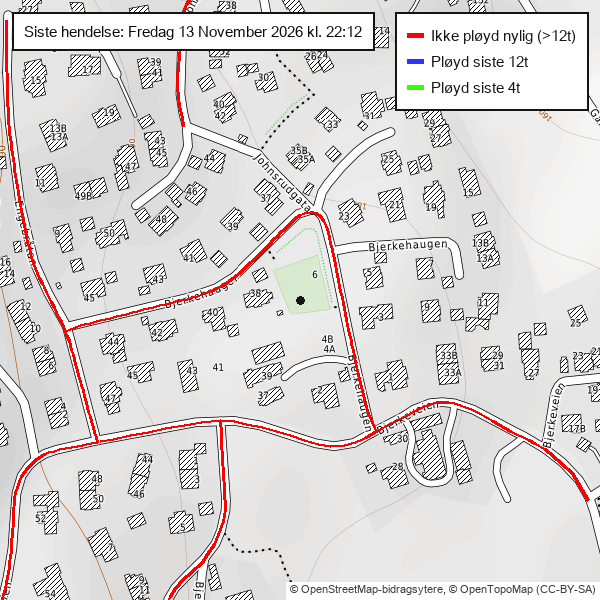

# Snow Plow Bot 🚜 (template)

A forkable bot that monitors snow-plow activity near **any address** covered by
a [PlogNorge](https://mobiwinqa.bmsystem.se/PlogNorge/baerum?groupId=80)
(Mobiwin / BM System) winter-maintenance map, renders a status map and posts
it to [Bluesky](https://bsky.app).

Everything location-specific lives in [`config.toml`](config.toml). This
repository's own instance watches **Bjerkehaugen 6, Lommedalen (Bærum)**.



## Make your own in 3 steps

1. **Fork** this repository.
2. **Edit [`config.toml`](config.toml)**:
   ```toml
   [location]
   name = "Torvet, Trondheim"      # shown in the post
   latitude = 63.4305
   longitude = 10.3951
   radius_m = 300                  # report road segments within this distance

   [plognorge]
   area = "trondheim"              # slug from the PlogNorge URL
   status_group_id = 59            # ?groupId=... (omit to use the first group)

   [post]
   hashtags = ["Brøyteweb", "trondheim", "snø"]

   [map]
   zoom = "auto"                   # or a fixed tile zoom (1-19)
   ```
   Run `python plowbot.py --list-groups` to see the status groups of an area.
3. **Add repository secrets** `BSKY_HANDLE` and `BSKY_PASSWORD` (a Bluesky
   [app password](https://bsky.app/settings/app-passwords)) under
   *Settings → Secrets and variables → Actions*, and enable Actions on your
   fork. Without secrets the workflow still runs in dry-run mode.

Optionally adjust the schedule in
[`.github/workflows/snow-plow-bot.yml`](.github/workflows/snow-plow-bot.yml)
(cron times are UTC).

## Available PlogNorge areas

Found by probing every Norwegian municipality name (Kartverket's list of 357
kommuner) against PlogNorge — re-run with `python scripts/discover_areas.py`.
Status as of November 2026:

| Area | `area` | Status groups (`status_group_id`) | Live map |
|------|--------|-----------------------------------|----------|
| Bærum | `baerum` | `80` Vintervedlikehold kommunalt veinett (4 h / 12 h) | [map](https://mobiwinqa.bmsystem.se/PlogNorge/baerum?groupId=80) |
| Bergen | `bergen` | `55` Vinterdrift (10 h / 24 h) | [map](https://mobiwinqa.bmsystem.se/PlogNorge/bergen?groupId=55) |
| Trondheim | `trondheim` | `77` GsA (2 h / 18 h), `78` GsB (2 h / 18 h), `59` Vinterdrift kommunale veier 24 timer (2 h / 24 h) | [map](https://mobiwinqa.bmsystem.se/PlogNorge/trondheim?groupId=77) |

The hours are the "recently plowed" / "plowed" thresholds used for colouring.
PlogNorge also has systems registered for **Kristiansand** and **Tysvær**
(systemId 4 and 6), but they have no public map URL at the moment. Bergen
returned no road segments at the time of writing (data may only be published
during active winter operations).

## Configuration reference

| Section | Key | Default | Description |
|---------|-----|---------|-------------|
| `location` | `name` | *required* | Name used in the post and alt text |
| | `latitude`, `longitude` | *required* | WGS84 coordinates of the address |
| | `radius_m` | `150` | Report segments within this distance |
| | `min_distance_m` | `0` | Ignore segments closer than this |
| `plognorge` | `area` | *required* | Area slug, see table above |
| | `status_group_id` | first group | Status group / layer to report |
| | `base_url` | `https://mobiwinqa.bmsystem.se/PlogNorge` | PlogNorge base URL |
| `post` | `hashtags` | `[]` | Hashtags (without `#`) |
| | `timezone` | `Europe/Oslo` | Time zone of PlogNorge timestamps |
| `map` | `output` | `plowmap.png` | Image file written (and committed by CI) |
| | `size_px` | `600` | Square image size |
| | `zoom` | `"auto"` | Tile zoom, or `"auto"` to fit `radius_m` |
| | `tile_url` | OpenTopoMap | XYZ tile URL template (`{z}/{x}/{y}`) |
| | `attribution` | OSM/OpenTopoMap | Attribution text drawn on the map |
| | `font` | auto-detect | Path to a `.ttf` font |

Use a different file with `--config path/to/file.toml` or the
`PLOWBOT_CONFIG` environment variable.

## How it works

1. GETs the area's PlogNorge page to establish a session and capture the
   ASP.NET `__RequestVerificationToken`.
2. Reads the area's status groups (`/Home/GetStatusGroups`) for colours and
   time thresholds, then POSTs `/Home/GetVisits` for the chosen group and
   parses all road segments (WKT `LINESTRING` / `POLYGON` / `POINT` geometry +
   `LatestVisitTime`).
3. Keeps the segments whose geometry comes within `radius_m` of the address.
4. Composes a post with the number of nearby segments, the most recent and
   oldest plow time and a link to the live map.
5. Renders a map image (`render_map.py`) centred on the address: raster
   tiles from `tile_url` (fetched with 0.2 s spacing; placeholder tiles are
   rejected), falling back to a plain schematic if no tiles load. Segments
   are drawn in PlogNorge's status colours with a matching legend and the
   latest event time.

## Example post

```
🚜 Plog-status Bjerkehaugen 6, Lommedalen (Bærum) (2026-11-22 18:56):
• 7 segmenter < 150 m
• Sist pløyd: 13.11.2026 kl 22.12
• Eldste: 13.11.2026 kl 21.47
Kart: https://mobiwinqa.bmsystem.se/PlogNorge/baerum?groupId=80
#Brøyteweb #bærum #bjerkefeltet #snø #vintervedlikehold
```

## Local usage

```
pip install -r requirements.txt
cp .env.example .env          # optional: fill in BSKY_HANDLE / BSKY_PASSWORD

python plowbot.py --list-groups   # status groups for the configured area
python plowbot.py --dry-run       # fetch, render map, print post (no posting)
python plowbot.py                 # fetch, render and post to Bluesky
python render_map.py              # only (re)render the map image
```

## Deployment

GitHub Actions ([`snow-plow-bot.yml`](.github/workflows/snow-plow-bot.yml))
runs the bot on a schedule — several times a day in November–March and daily
in spring/autumn — and commits the updated map image to `main`.

## Reference

- PlogNorge live maps: see the table above
- Bot pattern borrowed from GULBILBOT/gul-bil-bluesky
